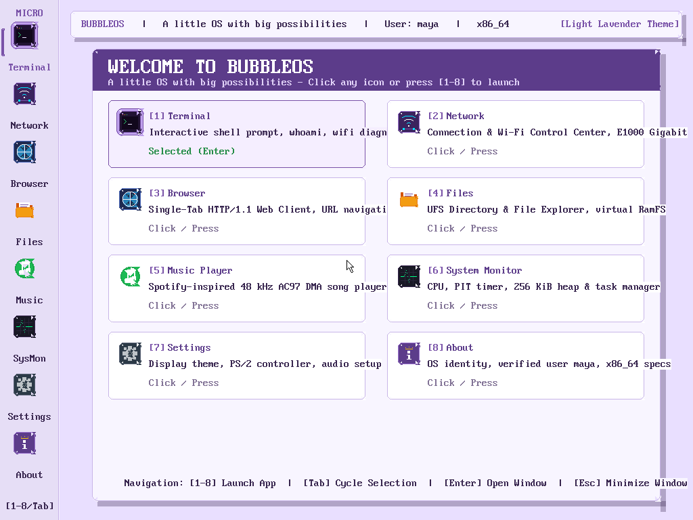
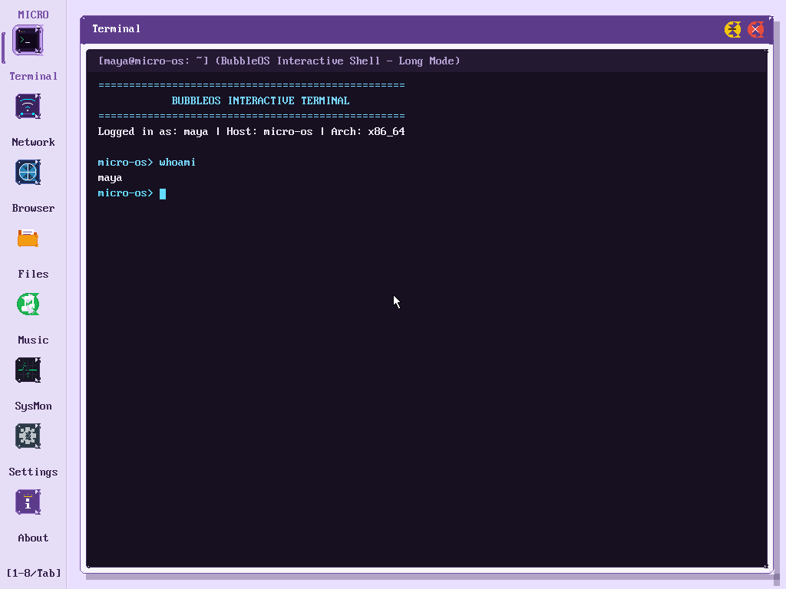
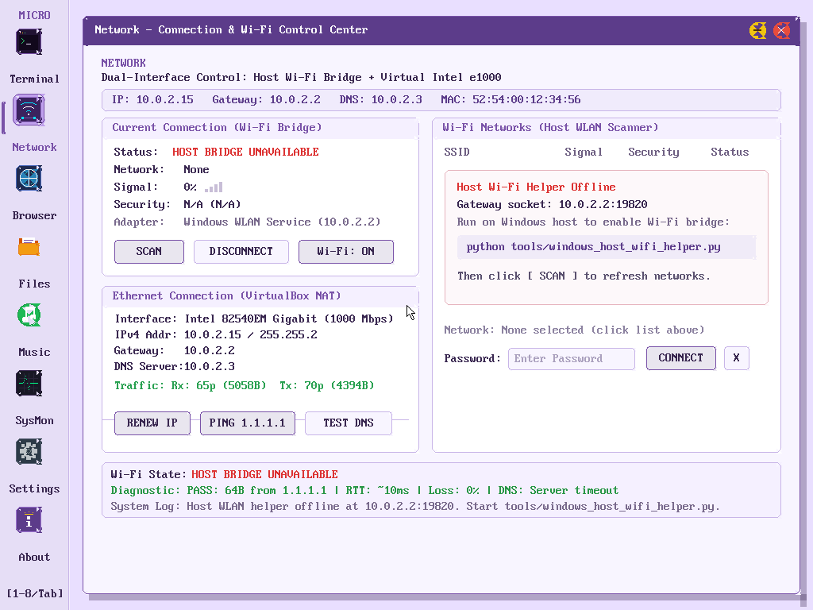
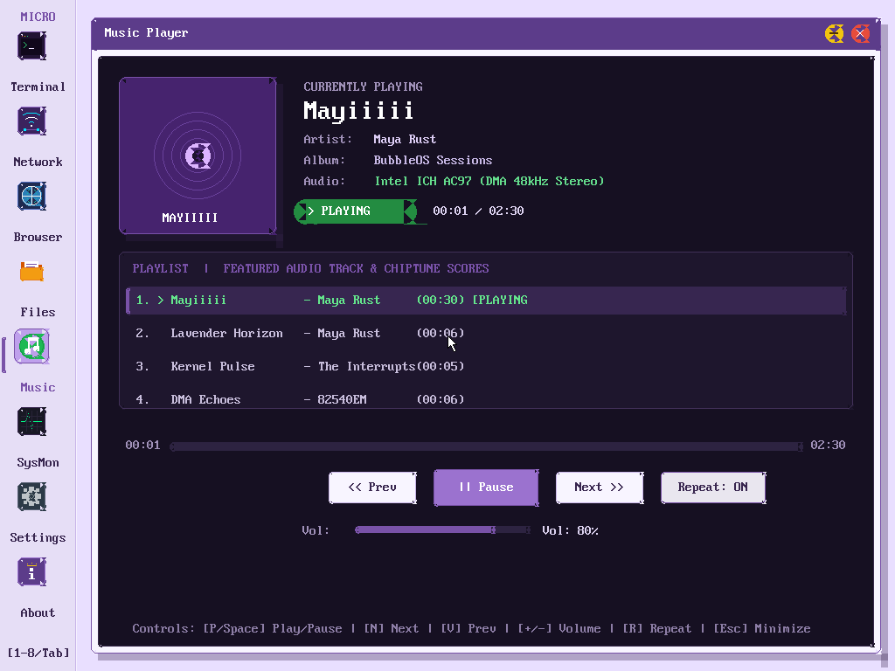

# BubbleOS

**A little OS with big possibilities.**

BubbleOS is a bare-metal, 64-bit educational operating system written in Rust for x86_64. It combines a custom kernel and hardware-facing subsystems with a lavender, pixel-based graphical desktop. The project began as Rust Micro-OS and grew through its operating-system milestones into BubbleOS.

<p align="center">
  
</p>

<p align="center">
  <a href="https://huggingface.co/mayaonsteroids/BubbleOS">Download the BubbleOS ISO</a> ·
  <a href="https://github.com/mayaonsteroids/Rust-Micro-OS/tree/milestone-17-network-browser">Source code (development branch)</a>
</p>


## Overview

BubbleOS boots into a 1024 × 768, 32-bit true-colour desktop rendered through a Bochs Graphics Adapter (BGA)-compatible framebuffer. The desktop uses a lavender visual theme, a window system, and an application dock.

The kernel also contains x86_64 task and process primitives, memory management and paging, interrupt handling, synchronization primitives, diagnostics, and an interactive shell. Networking is implemented over an emulated Intel 82540EM E1000 PCI Ethernet adapter; it is not a native physical Wi-Fi driver.

## Desktop

The desktop includes eight application areas:

- **Terminal** — interactive BubbleOS shell.
- **Network** — virtual Ethernet configuration and network diagnostics.
- **Browser** — single-tab, text-oriented HTTP browser.
- **Files** — file-browser interface.
- **Music Player** — AC'97 audio playback using the bundled track.
- **SysMon** — system information and monitoring interface.
- **Settings** — desktop settings interface.
- **About** — BubbleOS version and system information.

### PS/2 Mouse Support and Interactive Desktop

BubbleOS includes full PS/2 mouse hardware support:
- **Visible Pointer**: A classic 12×19 pixel-based arrow pointer with sub-microsecond double-buffer restoration for zero-flicker tracking.
- **Clickable Dock**: Clicking any of the 8 dock icons (Terminal, Network, Browser, Files, Music Player, SysMon, Settings, About) directly opens the application window.
- **Window Framing Controls**: Clickable minimize `[-]` and close `[X]` buttons in the window title bar.
- **Dashboard Quick-Launch**: Clicking any of the 8 home screen tiles opens the corresponding application.
- **Music Player Controls**: Clickable Play/Pause, Next, Previous, Repeat buttons, interactive volume slider, and direct playlist track selection.
- **Co-existent Controls**: Keyboard shortcuts (`1`..`8`, `Tab`, `Esc`, `Enter`) continue functioning seamlessly alongside the mouse.

Selected screenshots:

| Desktop | Terminal |
|---|---|
|  |  |

| Network | Music Player |
|---|---|
|  |  |

## Kernel and system features

- Rust `no_std` kernel targeting x86_64 long mode.
- BIOS El Torito optical boot with a 16-bit real-mode sector-translation shim.
- VGA text console and 16550 UART serial output.
- PS/2 keyboard and mouse input subsystems with IRQ 1 and IRQ 12 interrupt handling.
- 1024 × 768, 32-bit BGA framebuffer graphics, pixel drawing, window compositor, and desktop UI.
- Physical frame allocation, paging, kernel heap allocation, and address-space structures.
- Task lifecycle management, ready queue, context switching, timer interrupts, and round-robin scheduling.
- Process descriptors, per-process memory accounting, IPC mailboxes, sleep queue, and deferred cleanup.
- GDT, IDT, PIC, PIT, exception handling, and `int 0x80` system-call handling.
- SpinLock, IRQ-safe spinlock, and ticket-lock synchronization primitives.
- Kernel diagnostics, telemetry, and circular trace buffer.

## Networking

The network stack is built around the emulated Intel 82540EM (E1000) PCI Ethernet device and includes:

- PCI device discovery and E1000 initialization.
- Ethernet framing, ARP, and IPv4.
- ICMP, UDP, and TCP.
- DHCP address configuration and DNS A-record lookup.
- HTTP/1.1 GET requests and response handling.

Useful shell commands:

```text
pci
net
net info
net arp
net dhcp
net dns example.com
net ping <ip-address>
net tcp test [ip] [port]
http get example.com /
wifi
```

`wifi` displays network configuration and Wi-Fi/host-bridge diagnostics. The guest network interface itself is emulated Ethernet; BubbleOS does not currently contain a native Wi-Fi hardware driver.

## Browser

BubbleOS includes a single-tab, text-oriented browser that performs HTTP requests through the kernel TCP/IP stack and renders supported HTML text and links.

Launch it from the shell:

```text
browser
browser example.com
```

Browser controls:

| Input | Action |
|---|---|
| `g <url>` | Navigate to a URL |
| `f <number>` or a link number | Follow a displayed link |
| `b` | Go back |
| `r` | Reload |
| `u` / `d` | Scroll up / down |
| `t` | Return to the top |
| `home` | Open the browser home page |
| `q` | Close the browser and return to the shell |

**Browser limitation:** HTTPS/TLS is not implemented. The browser supports HTTP, not secure HTTPS connections, and is not a full modern browser with JavaScript execution.

## Music and audio

The Music Player uses the AC'97 audio controller and a bundled track at `assets/music/mayiiiii.mp3`. The project includes a conversion script and an IMA ADPCM audio payload used by the kernel audio path.

Audio output quality can vary with the emulated sound device and host environment.

## Identity and shell

The configured shell identity is `maya`.

```text
whoami
hostname
uname
uname -a
help
desktop
```

The default hostname is `micro-os`; this is the machine hostname and is separate from the operating-system name, BubbleOS.

Other shell commands include `clear`, `list`, `tasks`, `mem`, `trace`, `run <program>`, `audio`, `net`, `http`, and `browser`. Run `help` inside BubbleOS for the command list available in the current build.

## Build requirements

The project is developed for Linux or Windows Subsystem for Linux (WSL2) with a Rust nightly toolchain.

Required tools include:

- Rust nightly, `rust-src`, and `llvm-tools-preview`.
- `cargo-bootimage` (installed with `cargo install bootimage`).
- QEMU x86_64 system emulator.
- GNU assembler and `objcopy` (32-bit assembly support required for the boot shim).
- `xorriso`.
- Python 3 and the packages required by the project scripts.

Example Ubuntu/WSL2 setup:

```bash
sudo apt-get update
sudo apt-get install -y qemu-system-x86 build-essential xorriso binutils python3 python3-pip python3-pil python3-numpy
rustup default nightly
rustup component add rust-src llvm-tools-preview
cargo install bootimage
```

The audio conversion script additionally uses Python packages including NumPy, SciPy, and miniaudio.

## Build the kernel and ISO

From the repository root:

```bash
# Build the bare-metal boot image
cargo bootimage --target x86_64-unknown-none

# Assemble the boot shim and create the bootable ISO
python3 scripts/build_iso.py
```

The generated ISO is written to:

```text
iso/micro_os.iso
```

The ISO uses the volume ID `BUBBLEOS` and legacy BIOS El Torito boot. The build script expects the boot image at the configured Cargo output path.

## Run BubbleOS

Boot the ISO in QEMU:

```bash
qemu-system-x86_64 -boot d -cdrom iso/micro_os.iso -serial stdio
```

You can also attach `iso/micro_os.iso` as a virtual optical disk in a BIOS-mode VirtualBox virtual machine.

## Automated checks

The repository includes host-side verification scripts for the kernel milestones, network stack, browser, desktop, audio path, ISO structure, and boot process.

Examples:

```bash
python3 scripts/test_milestone17_1.py
python3 scripts/test_milestone17_2.py
python3 scripts/test_milestone17_3.py
python3 scripts/test_milestone17_4.py
python3 scripts/test_milestone17_5.py
python3 scripts/test_milestone17_6.py
python3 scripts/test_pixel_gui.py
python3 scripts/test_song_playback.py
python3 scripts/test_mouse_ps2.py
python3 scripts/test_milestone17_phase1.py
python3 scripts/test_iso.py
```

These scripts are test harnesses; run them in the documented development environment to obtain results for your own build. A successful host-side test does not replace checking the ISO in the target emulator or VM.

## Repository layout

```text
.
├── .cargo/       Cargo target and runner configuration
├── assets/       Bundled assets, including music
├── docs/         Architecture notes and milestone reports
├── iso/          Generated bootable ISO
├── screenshots/  Desktop, application, and milestone screenshots
├── scripts/      ISO build, conversion, inspection, and test scripts
├── src/
│   ├── audio/    AC'97 audio and playback
│   ├── browser/ HTTP browser engine and HTML handling
│   ├── console/  VGA, serial, and keyboard input
│   ├── graphics/ Framebuffer, drawing, fonts, and images
│   ├── gui/      Desktop, compositor, windows, and applications
│   ├── interrupts/
│   ├── memory/
│   ├── net/      Ethernet and network protocols
│   ├── pci/
│   ├── scheduler/
│   ├── shell/
│   ├── sync/
│   └── task/
└── submission/  Final report and selected milestone evidence
```

## Current limitations

- Networking uses an emulated E1000 Ethernet adapter. Native Wi-Fi hardware support is not implemented.
- HTTPS/TLS and certificate validation are not implemented; browser requests use HTTP.
- The browser is single-tab and text-oriented, with limited HTML rendering and no JavaScript engine.
- The current optical ISO is configured for legacy BIOS boot; native UEFI boot is not provided.
- The kernel targets a single virtual CPU in its current configuration.
- The Ring 3 demo programs are embedded in the kernel; loading arbitrary external ELF applications from a general-purpose disk filesystem is not implemented.

See `docs/` for the detailed architecture notes and historical milestone reports.

## Downloads

- **Bootable BubbleOS ISO:** [Download micro_os.iso from Hugging Face](https://huggingface.co/mayaonsteroids/BubbleOS/resolve/main/micro_os.iso)
- **Hugging Face repository:** [mayaonsteroids/BubbleOS](https://huggingface.co/mayaonsteroids/BubbleOS)
- **Source code:** [Rust-Micro-OS — milestone-17-network-browser](https://github.com/mayaonsteroids/Rust-Micro-OS/tree/milestone-17-network-browser)

## License

This project is released under the MIT License. See [LICENSE](LICENSE).
